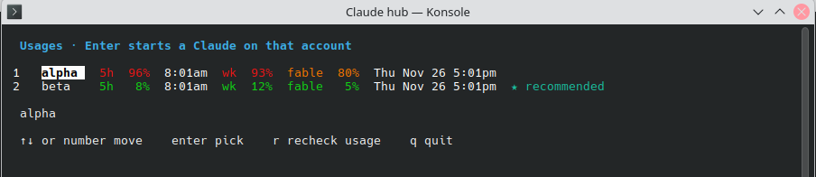

# claude-hub-linux

A Claude Code workstation setup for Kubuntu: a hub that shows every Claude you have running, automatic switching
between your Claude subscriptions before one runs out, one KDE desktop per Claude, and a set of hooks and skills.

> **Early version.** This was exported from one person's daily setup and published as it is, rough edges and all.
> It has been run on a single machine. Expect missing pieces, odd messages and things that only make sense on that
> machine. Issues and fixes are welcome. Read `install.sh` before you run it: it installs packages with `sudo`, links
> commands into `~/.local/bin`, enables systemd user services and loads KWin scripts.



*The hub's usage view. The two subscriptions and their numbers are made up for this picture.*

## What you get

- **The hub (`claude-hub`).** A popup listing every Claude session on the machine, with its state, its subscription
  and its desktop, so you can jump to one, start one, or see which are working and which are waiting for you.
- **Auto-switch (`claude-autoswap`).** Watches the usage meters of each subscription you have and moves a running
  Claude to another subscription just before it hits a limit, carrying the conversation along. The rule is below and,
  in full, in [docs/auto-switch.md](docs/auto-switch.md). `claude-account-menu` shows the meters and lets you move a
  Claude by hand.
- **One desktop per Claude (`claude-desks`).** Each Claude gets its own KDE virtual desktop, kept in order for you.
  Guards keep agents off your screen: a browser or window an agent opens goes to a hidden screen or its own
  desktop instead of landing on top of what you are doing, and a Claude cannot switch your current desktop.
- **Hooks and skills.** A small set of Claude Code hooks and skills, installed into every Claude account folder by a
  copy of the toolkit that comes with this repository. The hooks: `trail` (a note after each answer of what was asked
  and done, so the next session can pick up), `precompact-snapshot` (saves what a compaction summary loses),
  `resume-guard` (refuses to resume a conversation that is already running on any account),
  `screenshot-guard` (keeps browser screenshots out of the repository root), `window-guard` and
  `desktop-switch-guard` (an agent never opens a window on your desktop or switches the desktop you are looking at)
  and `bg` (starts long-running commands without terminal windows, and cleans them up).

## Requirements

- Kubuntu 26.04 or later (Ubuntu with KDE Plasma 6 works too), logged in to a **Plasma 6 Wayland** session. The
  installer refuses anything older or different.
- [Claude Code](https://docs.claude.com/en/docs/claude-code/setup) installed, with one or more Claude subscriptions
  to sign in to.
- Node.js 22 or later. The installer checks and tells you how to get it if the packages do not provide it.
- `sudo`, for the packages the installer needs: konsole, qdbus6 (`qdbus-qt6`), wl-clipboard, xdotool, wmctrl,
  python3 with PyQt6, dbus and GObject, jq, tmux, sqlite3, rsync, kpackagetool6 and the KDE config tools.

## Install

```sh
git clone https://github.com/philliplavrador/claude-hub-linux
cd claude-hub-linux
./install.sh
```

Options:

```text
./install.sh --parts hub,autoswap,desktops,toolkit   choose parts (default: all)
./install.sh --accounts work,home                    name your subscriptions up front
./install.sh --yes                                   no questions (see below: it makes no accounts by itself)
./install.sh --dry-run                               show what it would do, change nothing
```

The installer:

1. checks the machine (Kubuntu or Ubuntu 26.04+, Plasma 6, Wayland) and installs the packages the chosen parts need;
2. links the commands into `~/.local/bin` and copies the systemd user units to `~/.config/systemd/user`, then enables
   and starts them;
3. installs the KWin scripts for the desktops part with `kpackagetool6` and turns them on;
4. asks how many Claude subscriptions you have and what to call each, and makes `~/.claude-accounts/<name>/` for
   each. It registers the hooks it needs in each account's `settings.json`;
5. installs the hooks and skills into each account folder;
6. prints the sign-in step for each subscription:

   ```sh
   CLAUDE_CONFIG_DIR=~/.claude-accounts/<name> claude
   # then type /login and sign in with that subscription
   ```

**Log out and back in once after installing.** The background services (the session list the hub reads, the
desktops service) and the Meta+Return key start from your login, and only a new login gives them `~/.local/bin` on
their PATH and the key binding. The installer adds `~/.local/bin` to the services' PATH for the current session, so the
hub works at once, but log out and in anyway.

`./install.sh --yes` asks nothing, so without `--accounts` it makes no accounts: the hub then shows none. Name them
(`./install.sh --yes --accounts work,home`) or run it without `--yes` and answer the questions.

Run `./install.sh` again after `git pull` to update; it only changes what changed. Commands to try afterwards:
`claude-hub`, `claude-autoswap status`, `claude-desks list`.

Each subscription is a separate folder under `~/.claude-accounts/`, and `claude-autoswap` treats every folder there
as a subscription it may move Claudes between. Start a Claude on one with
`CLAUDE_CONFIG_DIR=~/.claude-accounts/<name> claude`.

## Limits on agent work (the desktops part)

The desktops part installs two limits that are on from the first login. Both are starting points: check them against
the cores and memory of your own PC.

- **`agents.slice`**, a systemd user slice that holds the agents' work (Claude Code sessions, test runs, browsers an
  agent opens): `CPUQuota=1800%` (18 cores at most), `MemoryHigh=44G` (above it the kernel slows the slice down) and
  `MemorySwapMax=16G`. To change them, edit `~/.config/systemd/user/agents.slice`, then run
  `systemctl --user daemon-reload`. Setting `CPUQuota` to 100% times your core count and `MemoryHigh` to about 70% of
  your memory is a reasonable start. The installer copies the file again on the next run, so keep your values in a
  drop-in instead: `systemctl --user edit agents.slice`.
- **`claude-agents-ceiling`** (the `claude-agents-ceiling.service` unit). It stops the one process inside that slice
  that has run away, and never stops a Claude: a program that is not a Claude and holds 16 GB of its own memory plus
  swap is stopped, and when the slice stalls at its memory ceiling the biggest such program is stopped after 15
  seconds. To change the 16 GB, edit `RUNAWAY_BYTES` in `bin/claude-agents-ceiling` in your clone and run
  `systemctl --user restart claude-agents-ceiling`. To turn it off, run
  `systemctl --user disable --now claude-agents-ceiling`. `claude-agents-ceiling watch --dry-run` says what it would
  stop without stopping anything.

## Permission prompts (off by default)

The Claudes the hub starts ask for permission the way Claude Code normally does. One switch changes that for every
Claude the hub starts: with `CLAUDE_HUB_SKIP_PERMISSIONS=1` in the environment, `claude-desks` and `claude-window`
add Claude Code's `--dangerously-skip-permissions` flag to the default flags of each Claude they start, so it runs
commands, edits and deletes files and reaches the network without asking you first. Any other value, or no value,
leaves the flag off. Flags you pass to `claude-window` yourself replace its default.

The risk is the one the flag's name says: nothing stops a mistake, a wrong command or an instruction hidden in a page
or file the Claude reads, because no prompt sits in between. Turn it on only for accounts and a machine where that is
acceptable, and not on a computer that holds anything you cannot afford to lose. To turn it on, set the variable in
the shell profile that starts the hub, then start the hub again. To turn it off, remove it.
`tests/test_skip_permissions.py` checks both states.

## The auto-switch rule, in plain words

Every minute, for each subscription, `claude-autoswap` reads three meters (the 5-hour meter, the week meter and the
per-model week meter for Fable), how fast the 5-hour meter has been rising, and how many Claudes on it are busy.

A Claude **must leave** its subscription when any of these is true: the week meter is at 100 percent, or it runs
Fable and the Fable meter is at 100 percent; the 5-hour meter would hit 100 within the next ten minutes at its current
speed (so two busy Claudes trip this about twice as early as one); the 5-hour meter is at 98 percent; or it has just
hit a limit.

It **moves** only when it is idle: not working, not waiting for your answer, nothing typed and unsent in its prompt,
not the window you are typing in, and not moved in the last 30 minutes. A Claude that has actually hit a limit moves
regardless of the 30 minutes, but still never over unsent text.

It goes to a subscription with room. A subscription is skipped when its week meter is within 5 points of the line
(95 or more), when the model needs Fable and the Fable meter is too, or when its 5-hour meter would hit 90 within ten
minutes. Among the rest it goes first to a week that ends within 24 hours and still has 10 or more points of room
(that room is lost at the reset), then to the week that resets soonest, and among subscriptions that reset together
to the one that **scores** best. The score favours spare capacity that will be lost soonest (room divided by hours
until reset), keeps the Fable and week meters running down together, requires 5-hour headroom for the next ten
minutes, and divides by one plus the number of busy Claudes already there, so work spreads out. If Fable is used up
everywhere, the Claude carries on as an Opus Claude. If nothing has room, it stays and the hub shows when it can
move.

No model is asked anything: it is arithmetic on the meters. It only reads; it never writes a credential. Moving a
Claude copies its conversation to the other subscription and resumes it there, which costs one full re-read of the
conversation, so it only happens near a limit. Details, formulas and failure handling:
[docs/auto-switch.md](docs/auto-switch.md).

## Tests

```sh
tests/run.sh
```

runs each test file on its own (`python3 -m pytest -q` for the Python ones, then the shell ones), so `pytest` has to
be installed. The tests use fake commands and fake account folders, not your real accounts.

## Licence

MIT, see [LICENSE](LICENSE).
